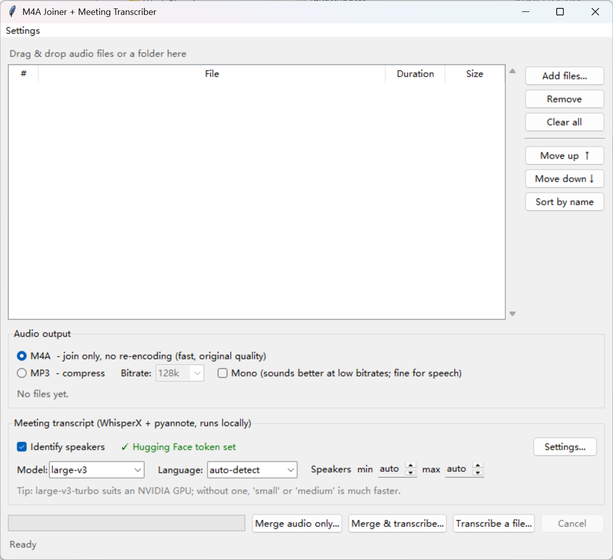

# Meeting Transcriber

A small desktop app for turning meeting recordings into transcripts that say who spoke when.
Everything runs locally on your computer.

- **Merge** split recordings (`.m4a`, `.mp3`, `.wav`, …) into one file. Drag files in, reorder them,
  and save as M4A (no re-encoding, original quality) or MP3 (smaller).
- **Transcribe** with [WhisperX](https://github.com/m-bain/whisperX): Whisper speech-to-text with word-level timing.
- **Identify speakers** with [pyannote](https://github.com/pyannote/pyannote-audio), then put names to
  them in a dialog that shows sample quotes from each speaker.
- The output is a plain `.txt` file with timestamps and speaker names.

Recordings never leave your machine. Models are downloaded from Hugging Face once and then cached.



## Quick start

**Windows:** double-click **`Start Meeting Transcriber.bat`**.
**macOS / Linux:** run `bash start.sh`.

On first start the script:

1. finds Python 3.10 – 3.13 and creates a virtual environment in `.venv`
2. installs the packages from `requirements.txt` (about 1 GB; takes a few minutes)
3. if you have an NVIDIA GPU, offers to switch PyTorch to the GPU build (about 2.5 GB, much faster)

Later starts skip all of this and open the app straight away.

You need **Python 3.10 – 3.13** with tkinter. WhisperX doesn't support 3.14 yet. On Windows, the
[python.org installer](https://www.python.org/downloads/) includes everything needed.
For a desktop icon, right-click the .bat and choose *Send to* > *Desktop (create shortcut)*.

### Speaker identification: one-time Hugging Face setup

The pyannote model is free but gated:

1. Create an account at <https://huggingface.co>.
2. Accept the conditions at <https://huggingface.co/pyannote/speaker-diarization-community-1>.
3. Create a **Read** token at <https://huggingface.co/settings/tokens>.
4. In the app, open **Settings**, paste the token and click **Check access**.
   Tick *Remember on this computer* to keep it for next time.

Without a token you still get a transcript, just without speaker labels.

## Using it

1. Drag the recordings (or their folder) onto the list. Fix the order by dragging, with *Move up/down*, or with *Sort by name*.
2. Choose the audio output: M4A or MP3.
3. Pick the Whisper model and language, and the number of speakers if you know it.
4. Click **Merge & transcribe…**, or **Merge audio only…** to just join the files. The transcript is saved
   next to the audio with the same name and `.txt`.
5. When it finishes, name the speakers. Give two speakers the same name to merge them; pyannote sometimes
   splits one person in two.

**Transcribe a file…** transcribes an existing recording without merging anything.
**Settings → Models** shows which models are downloaded, their size, and where they are stored.

### Choosing a model

| Model | Use when |
|---|---|
| `large-v3-turbo` (default) | NVIDIA GPU, or you don't mind waiting on CPU. Accurate. |
| `large-v3` | Hardest audio (accents, noise), with a GPU. Slowest. |
| `medium` / `small` | No NVIDIA GPU. Much quicker, somewhat less accurate. |

On a GPU, an hour of audio takes a few minutes. On CPU it can take about as long as the recording, or longer.

Auto-detect picks the language from the first 30 seconds. If a meeting starts in another language,
or mixes languages, choose the main one explicitly.

### Output example

```
MEETING TRANSCRIPT

Recording: meeting_combined.m4a
Created:   2026-11-06 23:24
Length:    1:02:13
Language:  en
Speakers:  Alice, Bob

------------------------------------------------------------

[00:00:03] Alice:
Good morning everyone. Let's start with the budget.

[00:00:11] Bob:
I think we are on track, but the timeline is tight.
```

## Command line

`transcriber.py` also works on its own, with the venv's Python:

```
.venv\Scripts\python transcriber.py meeting.m4a                 # -> meeting.txt
.venv\Scripts\python transcriber.py meeting.m4a --model small --language en --min-speakers 2 --max-speakers 4
.venv\Scripts\python transcriber.py meeting.m4a --no-diarize    # no token needed
```

The token comes from `--hf-token` or the `HF_TOKEN` environment variable.

## Project layout

| File | Purpose |
|---|---|
| `Start Meeting Transcriber.bat` / `start.sh` | Launchers. They create the venv on first run, then start the app. |
| `setup_check.py` | First-run setup: installs `requirements.txt` and optionally the GPU build of PyTorch. Fast no-op once done. |
| `m4a_joiner.py` | The app window: merging, settings, speaker naming. |
| `transcriber.py` | WhisperX + pyannote pipeline. The app runs it as a subprocess; it's also a CLI. |
| `requirements.txt` | Python dependencies. |

Settings, including the token if you choose to remember it, are stored in plain text in
`~/.m4a_joiner.json` (`%USERPROFILE%\.m4a_joiner.json` on Windows), not in this folder.
Models are cached in `~/.cache/huggingface/hub` and `~/.cache/torch/hub`.

## Troubleshooting

- **Setup fails to download packages:** check your internet connection or VPN, and look for a stale
  extra package source with `pip config list`. Fix it and start again; setup continues where it stopped.
- **Redo setup:** delete the `.venv` folder, or run `.venv\Scripts\python setup_check.py --force`.
  The `--force` option also asks the GPU question again.
- **The window doesn't open:** run `"Start Meeting Transcriber.bat" debug` from a terminal to see the error.
- **GPU errors mentioning cuDNN/cuBLAS DLLs:** update the NVIDIA driver, or install CUDA 12.8 + cuDNN 9 as
  described in the WhisperX README. The app also works on CPU.
- **"torchcodec is not installed correctly…" warning:** harmless. Audio is decoded with ffmpeg and passed to pyannote in memory.
- **Speaker identification fails (401 / gated repo):** use *Check access* in Settings. It tells you whether the
  token is invalid or the model conditions haven't been accepted.
- **Too many or too few speakers:** set *min* / *max* speakers to the real number.
- **Out of GPU memory:** choose a smaller model.

## License

[MIT](LICENSE). WhisperX, pyannote and the downloaded models have their own licenses and terms.
